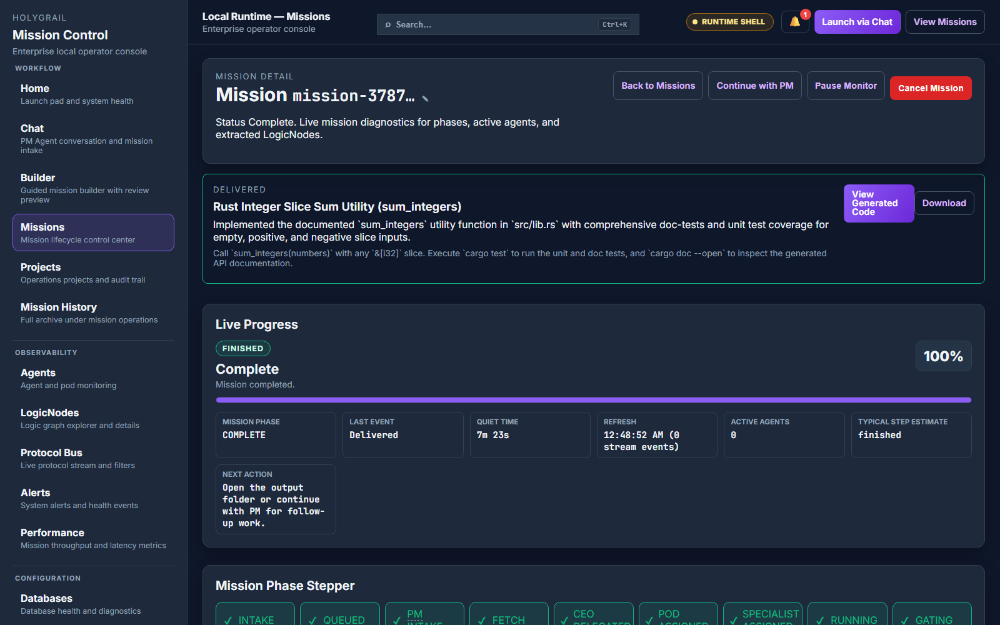
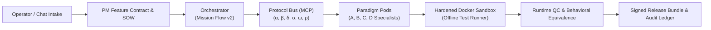

<div align="center">

# 🏭 theFactory

**An AI software factory — not a code-completion tool.**

*theFactory is an event-driven AI software factory for building, modernizing, debugging, porting, and validating applications through task-activated specialist agents, multi-provider model routing, isolated workspaces, ephemeral runtime test environments, runtime QC, and audit-ready evidence.*

[](https://github.com/kherrera6219/theFactory/actions/workflows/ci.yml)
[](https://github.com/kherrera6219/theFactory/actions/workflows/security.yml)
[](docs/TESTING_QUALITY_GATES.md)
[](scripts/production_review_audit.py)
[](pyproject.toml)
[](apps/mission-control/package.json)
[](LICENSE)



</div>

---

## 30-Second Overview

theFactory is a **governed, event-driven software manufacturing system**. Unlike prompt-and-pray "vibe coding" tools, it transforms user requirements into a binding Statement of Work (SOW), plans architecture across four paradigm pods, delegates tasks to 20 language specialists, and compiles, executes, and verifies code inside an offline, non-root sandbox before acceptance.

| Normal "Vibe Coding" | theFactory Enterprise Pipeline |
|---|---|
| Single prompt-to-code chat loop | Formal 11-phase state machine (Mission Flow v2) |
| Implicit, unverified dependencies | Zero unnecessary third-party dependencies |
| Uncontained host or VM execution | Hardened sandbox (`--user=65534`, `--pids-limit=256`, `--network=none`) |
| Assumes LLM output is correct | Implementation-blind behavioral equivalence & runtime QC |
| Ephemeral or missing evidence | Digitally signed cryptographic audit and evidence bundles |

---

## Architecture Pipeline



- **Protocol Bus**: Typed Redis streams for Directives (`α`), Production (`β`), Audit (`δ`), Knowledge (`σ`), User (`ω`), and Traffic Control (`ρ`).
- **Paradigm Pods**: 
  - **Pod A (Dynamic)**: Python, JavaScript, TypeScript, Ruby, PHP
  - **Pod B (Systems)**: C, C++, Rust, Go, Zig
  - **Pod C (Enterprise)**: Java, C#, Scala, Kotlin
  - **Pod D (Mathematical/Functional)**: R, MATLAB, Julia, Mathematica, Haskell, OCaml
- **Semantic Engine**: AST extractors (Python, JS/TS, Java) and deterministic Refined-IR syntax synthesis.

---

## 3-Step Quick Start

### 1. Prerequisites & Environment Setup
Clone the repository and generate local TLS certificates for PostgreSQL and Redis:
```bash
git clone https://github.com/kherrera6219/theFactory.git
cd theFactory
cp .env.example .env
make tls-certs
```

### 2. Choose Your Deployment Topology

- **Standard Condensed Mode (Default & Recommended)**: Shared pod worker containers with synthesized heartbeats for fast local development and lower memory footprint:
  ```bash
  make up-condensed
  # Or: docker compose -f deploy/docker-compose.yaml up -d
  ```

- **Full Dedicated Mode**: Complete isolated container topology per agent manager and specialist:
  ```bash
  make up-full-dedicated
  # Or: docker compose -f deploy/docker-compose.yaml -f deploy/docker-compose.full-dedicated-agents.yaml --profile full-dedicated-agents up -d
  ```

### 3. Open Mission Control
Open [http://localhost:3000](http://localhost:3000) to access the operator console, draft SOWs, and monitor real-time mission execution.

---

## LLM Provider Support & Egress Governance

theFactory supports both managed cloud providers and 100% offline local LLM runtimes:

- **Local Air-Gapped (Zero Cloud Egress)**: Native Ollama and vLLM support via `LLM_PROVIDER=ollama` and `OLLAMA_BASE_URL=http://localhost:11434` (supports `deepseek-coder`, `qwen2.5-coder`, `llama3.3`).
- **Cloud Providers**: Native support for **Google Gemini** (default: `gemini-3.8-flash`), **Anthropic Claude**, and **OpenAI GPT**.
- **Fail-Closed Protection**: Unrecognized or unconfigured LLM providers are rejected immediately with descriptive errors, eliminating accidental cloud prompt leakage.

Read the [Local-First Compliance Guide](docs/LOCAL_FIRST_COMPLIANCE_PLAN.md) for full instructions.

---

## Quality Gates & Verification

Every pull request and release is validated against strict automated quality gates:

```bash
# Run full verification suite (lint, schemas, pytest, and frontend tests)
make validate

# Run backend pytest with 80%+ line and branch coverage gates
make test

# Run Mission Control TypeScript checks and Vitest suite
make test-ui

# Audit production readiness and repo hygiene
make audit
```

---

## Repository Layout

```
theFactory/
├── apps/mission-control/         # Next.js 16 operator console & Electron desktop app
├── services/
│   ├── api-gateway/              # Modular FastAPI proxy, auth, SSE transport
│   ├── orchestrator/             # Mission state machine, agent registry, LLM routing
│   ├── pod-worker/               # Paradigm pod workers & AST language extractors
│   ├── audit-worker/             # Verification & digital signing stream processor
│   ├── protocol-bus-mcp/         # Typed 6-lane Redis message bus
│   └── sandbox-runner/           # Hardened, non-root Docker sandbox execution runner
├── shared_runtime/               # Domain taxonomy, crypto signing, atomic I/O, PII guard
├── deploy/                       # Docker Compose stacks, socket proxy, monitoring configs
├── docs/                         # Canonical architectural decision records and runbooks
└── tests/                        # Comprehensive unit, integration, and security test suites
```

---

## Documentation Index

- [Architecture & Data Flows](docs/ARCHITECTURE.md)
- [Mission Lifecycle & Flow v2](docs/MISSION_FLOW_V2.md)
- [Architectural Decision Records (ADR)](docs/ADR_DESIGN_RECONCILIATION_2026-08-01.md)
- [Testing & Quality Gates](docs/TESTING_QUALITY_GATES.md)
- [Local-First Compliance Plan](docs/LOCAL_FIRST_COMPLIANCE_PLAN.md)
- [Full Documentation Index](docs/DOCUMENTATION_INDEX.md)
- [Change History](CHANGELOG.md)

---

## License

theFactory is open-source software licensed under the [MIT License](LICENSE).
