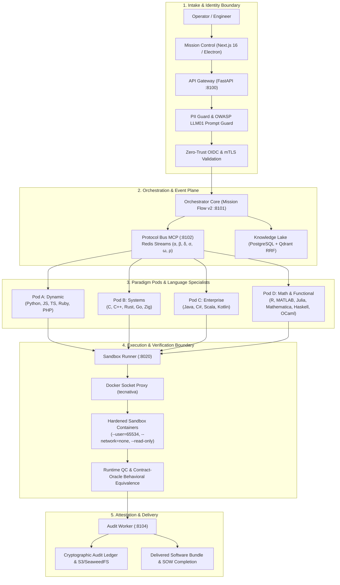
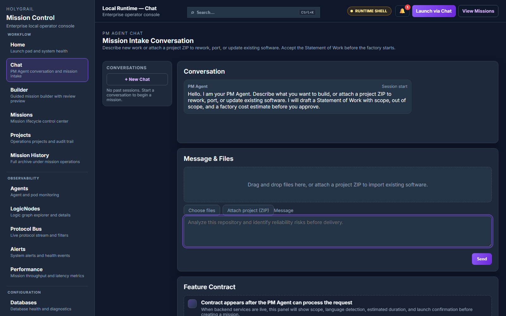
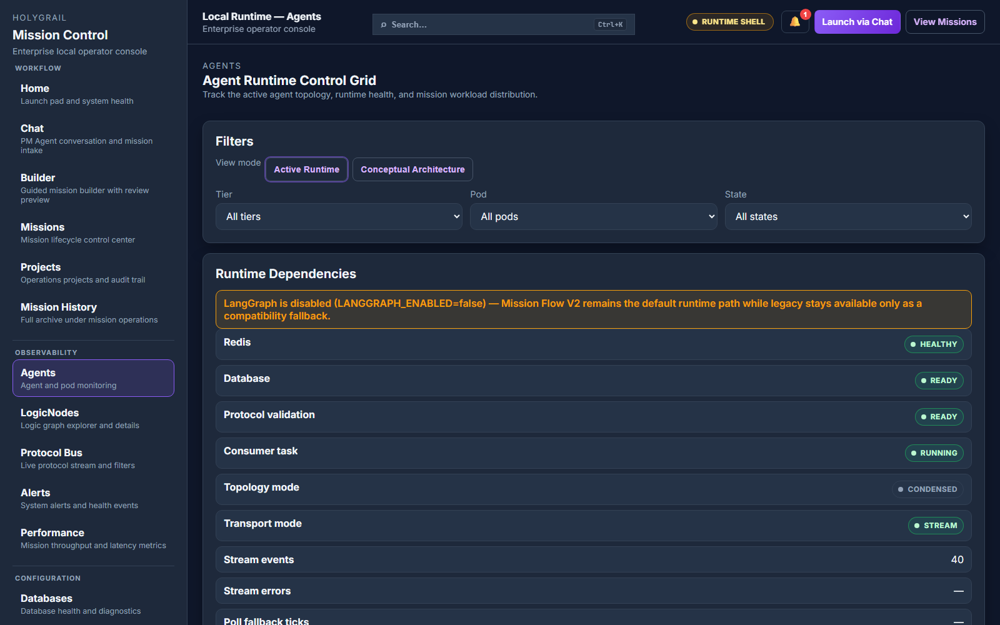
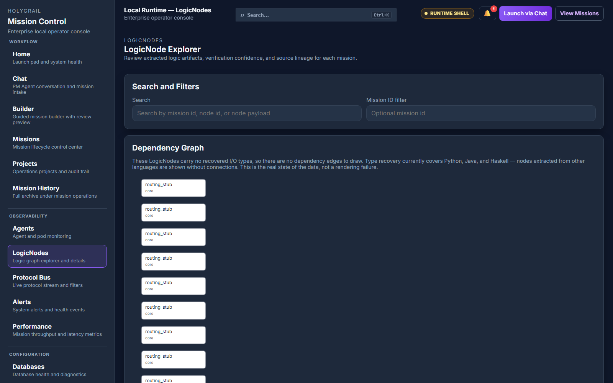
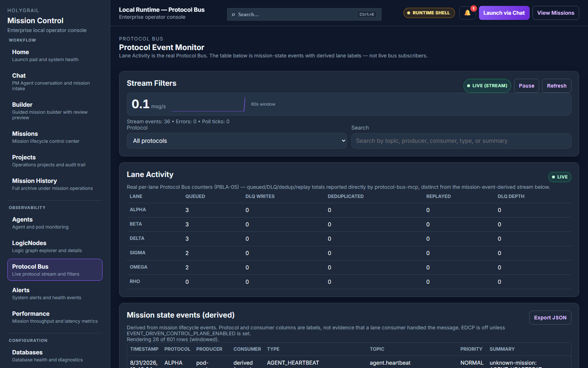
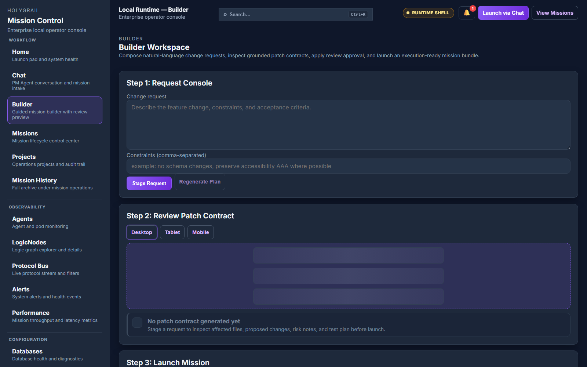
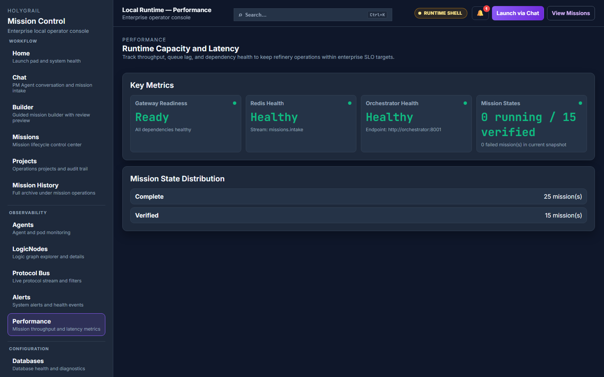
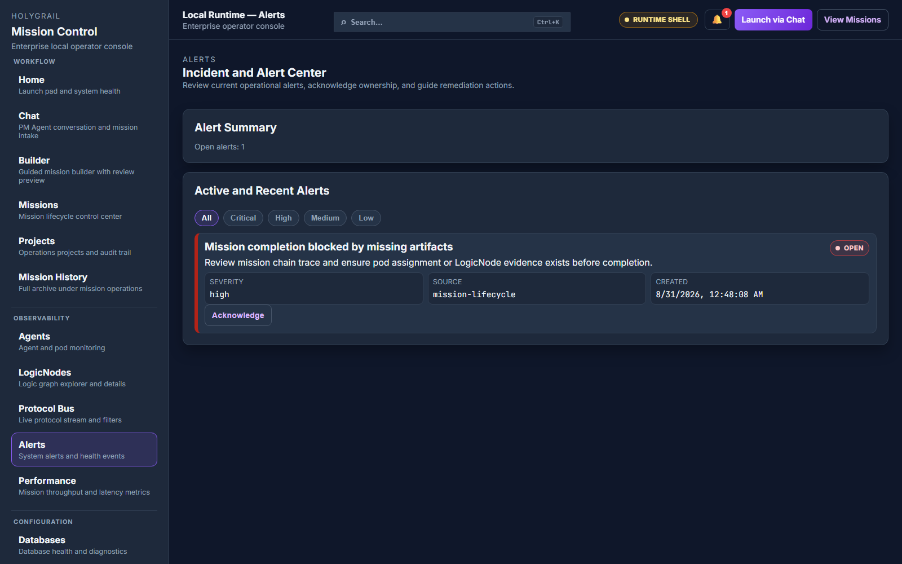

<div align="center">

# 🏭 theFactory

**An AI software factory — not a code-completion tool.**

*theFactory is an enterprise-grade, event-driven, local-first AI software manufacturing system. It builds, modernizes, debugs, secures, ports, and validates complex multi-file software applications through task-activated specialist agents, multi-provider model routing, dependency absorption, isolated workspaces, ephemeral runtime test environments, AI runtime QC, and audit-ready cryptographic evidence.*

[](https://github.com/kherrera6219/theFactory/actions/workflows/ci.yml)
[](https://github.com/kherrera6219/theFactory/actions/workflows/security.yml)
[](docs/TESTING_QUALITY_GATES.md)
[](scripts/production_review_audit.py)
[](pyproject.toml)
[](apps/mission-control/package.json)
[](LICENSE)

<br/>


<sub><a href="#mission-control-views--operator-console">Explore all 16 Mission Control views →</a></sub>

</div>

---

> **Key Architecture & Operational Highlights:**
> - **20 Language Toolchains**: Automated syntax parsing, AST extraction, and isolated test execution across 20 languages.
> - **41 Specialist Agents**: Role-based multi-agent architecture spanning executive planning, paradigm pods, language specialists, and quality control.
> - **Hardened Container Sandbox**: Untrusted code executes in an unprivileged, non-networked Docker container (`--user=65534`, `--network=none`, `--read-only`).
> - **Native Desktop & Web UI**: Mission Control operator console available as both a web application and a native Windows desktop app.
> - **Flexible Model Support**: First-class support for Google Gemini 3.8 Flash, Anthropic Claude, OpenAI, and fully offline local LLMs via Ollama.
> - **Dynamic Deployment Topologies**: One-command scaling between lightweight condensed mode and a 41-container dedicated fleet.

---

## Table of Contents

1. [What Makes theFactory Different](#what-makes-thefactory-different)
2. [High-Level Architecture](#high-level-architecture)
3. [The Six Redis Protocol Lanes](#the-six-redis-protocol-lanes)
4. [The 7-Phase Smelt Cycle](#the-7-phase-smelt-cycle)
5. [The 41-Agent Registry & Paradigm Pods](#the-41-agent-registry--paradigm-pods)
6. [20 Supported Languages & Offline Test Runners](#20-supported-languages--offline-test-runners)
7. [Hardened Sandbox & Security Model](#hardened-sandbox--security-model)
8. [Zero-Trust Multi-Tenant OIDC & mTLS](#zero-trust-multi-tenant-oidc--mtls)
9. [Windows Desktop Application](#windows-desktop-application)
10. [Dynamic Topology Orchestration](#dynamic-topology-orchestration)
11. [LLM Provider Support & Egress Controls](#llm-provider-support--egress-controls)
12. [3-Step Quick Start](#3-step-quick-start)
13. [Makefile & Operational CLI Reference](#makefile--operational-cli-reference)
14. [Mission Control Views & Operator Console](#mission-control-views--operator-console)
15. [How theFactory Works: In-Depth Walkthrough](#how-thefactory-works-in-depth-walkthrough)
16. [Documentation Index & License](#documentation-index--license)

---

## What Makes theFactory Different

theFactory is not an inline autocomplete widget, chat tab, or "vibe coding" assistant. It is a **governed software refinery**. It takes natural language business requirements, establishes a binding Statement of Work (SOW) contract, maps architectural requirements to specialized paradigm pods, generates modular source code across 20 languages, and subjects every line to offline sandbox execution and implementation-blind behavioral equivalence testing before delivery.

| Dimension | Ordinary AI Code Assistants / Vibe Coding | theFactory Enterprise AI Software Refinery |
|---|---|---|
| **Execution Flow** | Single prompt-to-code loop without state guarantees | Formal 11-phase state machine (Mission Flow v2) with idempotent recovery |
| **Contract Governance** | Vague chat prompts with no boundary agreements | Binding Statement of Work (SOW) feature contracts and budget limits |
| **Agent Architecture** | 1 general-purpose model attempting everything | 41 certified specialists organized into 4 paradigm pods and support rings |
| **Sandbox Isolation** | Code executes directly on user host or privileged VM | Non-root sandbox (`--user=65534`, `--pids-limit=256`, `--network=none`) |
| **Quality Verification** | Assumes code is functional if LLM generates it | Runtime QC with offline vendored test runners and contract oracles |
| **Inter-Service Bus** | Unstructured REST calls or tight couplings | 6 typed Redis protocol streams with W3C distributed tracing context |
| **Data Integrity** | Vector-only semantic search prone to hallucinations | Reciprocal Rank Fusion (RRF) combining dense vectors and sparse lexical search |
| **Security & Identity** | Static API keys or developer-mode defaults | Strict multi-tenant OIDC claim validation and inter-service mutual TLS |
| **Audit Readiness** | Missing or ephemeral chat histories | Digitally signed cryptographic audit ledgers and SHA-256 evidence bundles |
| **Deployment Modes** | Monolithic local dev only | Dynamic switching between lightweight condensed and 41-container dedicated stacks |

---

## High-Level Architecture

theFactory is built as a modular microservice monorepo coordinated by typed Redis Streams, asynchronous background workers, and persistent PostgreSQL and vector storage:



---

## The Six Redis Protocol Lanes

All internal inter-service and inter-agent communication flows across **six isolated Redis protocol streams**. Every message envelope conforms to `schemas/event.envelope.schema.json` and carries W3C OpenTelemetry distributed tracing headers (`traceparent`, `tracestate`) for full end-to-end observability:

| Protocol Lane | Greek Key | Channel Pattern | Purpose & Payload |
|---|:---:|---|---|
| **Alpha (α)** | `α` | `protocol.alpha.directive` | **Executive Directives**: Commands, state transitions, mission cancel/pause, and SOW approvals issued by CEO and PM agents. |
| **Beta (β)** | `β` | `protocol.beta.production` | **Production Artifacts**: Code synthesis batches, AST symbol trees, Refined-IR nodes, and build scripts transmitted between specialists and pod managers. |
| **Delta (δ)** | `δ` | `protocol.delta.audit` | **Audit & Verification**: Cryptographic signatures, verification evidence hashes, test results, and compliance gate receipts handled by the Audit Worker. |
| **Sigma (σ)** | `σ` | `protocol.sigma.knowledge` | **Knowledge Plane**: Reciprocal Rank Fusion hybrid search queries, bootstrap language documentation, and embeddings synced between PostgreSQL and Qdrant. |
| **Omega (ω)** | `ω` | `protocol.omega.user` | **Operator Telemetry**: Server-Sent Events (SSE), live agent health telemetry, live terminal logs, and progress indicators streamed to Mission Control. |
| **Rho (ρ)** | `ρ` | `protocol.rho.traffic` | **Traffic Control**: Rate limits, dead-letter queue (DLQ) ingestion, service circuit-breaker triggers, and backpressure signals. |

---

## The 7-Phase Smelt Cycle

Every mission progresses through the factory's deterministic **Smelt Cycle (MVP v1.3 / Mission Flow v2)**:

```
[ INTAKE ] ➔ [ FETCH ] ➔ [ SMELT ] ➔ [ GATING ] ➔ [ FUSION ] ➔ [ SQUEEZE ] ➔ [ DELIVERY ]
```

1. **INTAKE**: Natural language user requirements are parsed by the PM Agent (`AGENT-01-PM`). The input is screened by PII Guard and OWASP LLM01 Prompt Injection detectors. A binding **Statement of Work (SOW)** feature contract with acceptance criteria is established.
2. **FETCH**: The system queries the Knowledge Lake using **Reciprocal Rank Fusion (RRF)** hybrid search, pulling both dense vector semantic embeddings and exact symbol keyword matches (e.g. `MISRA-C:2012`, framework idioms).
3. **SMELT**: The targeted Pod Manager routes tasks to certified language specialists. Code is synthesized according to professional domain groundings (RAII for Pod B, SOLID for Pod C, OWASP for Pod A).
4. **GATING**: Synthesized code undergoes toolchain preflight syntax verification across AST extractors and native compilers. Syntax defects trigger immediate self-healing loops.
5. **FUSION**: Multi-file artifacts, directory structures, and dependencies are unified into isolated project workspaces with immutable change ledgers.
6. **SQUEEZE**: Hardened Docker test execution. The artifact is mounted read-only into an ephemeral sandbox without network access. Offline test runners execute generated unit tests; implementation-blind contract oracles evaluate behavioral equivalence.
7. **DELIVERY**: The Audit Worker signs the delivery manifest with digital HMAC/ed25519 signatures, archives the evidence bundle to SeaweedFS Object Lock storage, and transitions the mission to `COMPLETE`.

---

## The 41-Agent Registry & Paradigm Pods

theFactory organizes its autonomous workforce into an audited **41-agent registry**. Every agent runs real health probes measuring process RSS memory, round-trip probe latency, and contract integrity:

```
├── Executive & Interface
│   ├── AGENT-01-PM           (Product Manager — Intake, SOW Contract, Feature Boundary)
│   └── AGENT-02-CEO          (Chief Executive — Strategic Planning, Global Allocations)
├── Pod Managers & Sub-Managers
│   ├── AGENT-12-PODA-MGR     (Pod A Manager — Dynamic & Scripting Languages)
│   ├── AGENT-18-PODB-MGR     (Pod B Manager — Systems & Compiled Languages)
│   ├── AGENT-24-PODC-MGR     (Pod C Manager — Enterprise & Managed Virtual Machine)
│   └── AGENT-30-PODD-MGR     (Pod D Manager — Mathematical & Functional Languages)
├── Pod Audit & Quality Control
│   ├── AGENT-13-PODA-AUDIT   (Pod A Audit & Static Analysis)
│   ├── AGENT-19-PODB-AUDIT   (Pod B Audit & MISRA/Buffer Safety)
│   ├── AGENT-25-PODC-AUDIT   (Pod C Audit & JVM/CLR Hygiene)
│   └── AGENT-31-PODD-AUDIT   (Pod D Audit & Type-Theoretic Proofs)
├── Support Ring (Cross-Cutting Specialists)
│   ├── AGENT-03-BROKER       (API & Integration Broker)
│   ├── AGENT-04-ACCOUNTANT   (Token Cost & Spend-Cap Estimator)
│   ├── AGENT-05-SECURITY     (OWASP, Secret Scanning & Threat Modeling)
│   ├── AGENT-06-IS           (Information Systems & Knowledge Curator)
│   ├── AGENT-07-VC           (Version Control & Git Lineage Coordinator)
│   ├── AGENT-08-COMPLIANCE   (License Attestation & Regulatory Auditing)
│   ├── AGENT-09-HW           (Hardware Architecture & Target Mapping)
│   ├── AGENT-10-TESTER       (System Integration & Test Suite Author)
│   ├── AGENT-11-DEPLOY       (Deployment & Containerization Engineer)
│   ├── AGENT-39-DEPABS       (Dependency Absorption Specialist)
│   ├── AGENT-40-TESTDATA     (Mock Data & Boundary Vector Generator)
│   └── AGENT-41-RQCA         (Runtime Quality Control & Verdict Authority)
└── Language Specialists (19 Specialists covering 20 Languages)
    ├── Pod A: AGENT-14-PYTHON, AGENT-15-JAVASCRIPT, AGENT-16-RUBY, AGENT-17-PHP
    ├── Pod B: AGENT-20-C, AGENT-21-CPP, AGENT-22-RUST, AGENT-23-ZIG, AGENT-36-GO
    ├── Pod C: AGENT-26-JAVA, AGENT-27-CSHARP, AGENT-28-SCALA, AGENT-29-KOTLIN
    └── Pod D: AGENT-32-MATLAB, AGENT-33-R, AGENT-34-JULIA, AGENT-35-MATHEMATICA, AGENT-37-HASKELL, AGENT-38-OCAML
```

---

## 20 Supported Languages & Offline Test Runners

Every language in theFactory is backed by a certified specialist agent, a toolchain syntax validator, and an offline vendored test runner:

| Paradigm Pod | Language | Specialist Agent | Extraction Engine | Vendored Offline Test Runner | Grounding Standard |
|---|---|---|---|---|---|
| **Pod A (Dynamic)** | **Python** | `PythonAgent` | Python native `ast` | `pytest 9.1.1` (hash-pinned) | PEP 8 / PEP 604, Type Hints |
| **Pod A (Dynamic)** | **JavaScript** | `JavascriptAgent` | `esprima` AST parser | `vitest 4.1.11` (Node 20 slim) | ECMAScript 2024, Node.js LTS |
| **Pod A (Dynamic)** | **TypeScript** | `JavascriptAgent` | `esprima` (type-stripped) | `vitest 4.1.11` + `tsc 5.9.3` | Strict TypeScript, Zero `any` |
| **Pod A (Dynamic)** | **Ruby** | `RubyAgent` | Regex concept detection | `minitest` / `rake test` | Idiomatic Ruby 3.x, RuboCop |
| **Pod A (Dynamic)** | **PHP** | `PhpAgent` | Regex concept detection | `PHPUnit 11.5.39` (phar) | PSR-12, Strict typing |
| **Pod B (Systems)** | **C** | `CAgent` | Regex concept detection | GCC 13 / Clang test runner | MISRA C:2012, Safe memory |
| **Pod B (Systems)** | **C++** | `CppAgent` | Regex concept detection | GCC 13 / Clang Catch2 runner | Modern C++20, RAII, Smart ptrs |
| **Pod B (Systems)** | **Rust** | `RustAgent` | Regex concept detection | `cargo test` (Rust 1.78) | Zero unsafe, Clippy clean |
| **Pod B (Systems)** | **Go** | `GoAgent` | Concrete SpecialistAgent | `go test` (Go 1.22) | Uber Go Style Guide, Error checks |
| **Pod B (Systems)** | **Zig** | `ZigAgent` | Regex concept detection | `zig test` (Zig 0.12) | Explicit allocations, Comptime |
| **Pod C (Enterprise)** | **Java** | `JavaAgent` | `javalang` AST parser | `JUnit 5 Platform 1.11.4` | Java 21 LTS, SOLID patterns |
| **Pod C (Enterprise)** | **C#** | `CsharpAgent` | Regex concept detection | `.NET 10 LTS` + `xUnit 2.9.3` | Modern C# 13, Async hygiene |
| **Pod C (Enterprise)** | **Scala** | `ScalaAgent` | Regex concept detection | `ScalaTest 3.2.19` (17-jar BOM) | Scala 3.4.0, Functional purity |
| **Pod C (Enterprise)** | **Kotlin** | `KotlinAgent` | Regex concept detection | `Kotlin 2.4.20` + `JUnit 5` | Idiomatic Kotlin, Coroutine safety |
| **Pod D (Math/Func)** | **R** | `RAgent` | Regex concept detection | `testthat` (CRAN snapshot) | Tidyverse, Vectorized operations |
| **Pod D (Math/Func)** | **MATLAB** | `MatlabAgent` | Regex concept detection | MATLAB test harness runner | Vectorized matrix operations |
| **Pod D (Math/Func)** | **Julia** | `JuliaAgent` | Regex concept detection | Julia native `Test` package | Multiple dispatch, Type stability |
| **Pod D (Math/Func)** | **Mathematica** | `MathematicaAgent` | Regex concept detection | Symbolic rule evaluation | Pure functional transformations |
| **Pod D (Math/Func)** | **Haskell** | `HaskellAgent` | Concrete SpecialistAgent | `HUnit` / GHC test runner | Total functions, Strong types |
| **Pod D (Math/Func)** | **OCaml** | `OcamlAgent` | Concrete SpecialistAgent | `OUnit2` / Dune test runner | Pattern matching, Functor hygiene |

---

## Hardened Sandbox & Security Model

Generated code execution is treated as **hostile by default**. Runtime QC and behavioral equivalence share a single, hardened execution path in `sandbox_exec.py`:

```python
SANDBOX_SECURITY_FLAGS: tuple[str, ...] = (
    "--user=65534:65534",                     # Non-root unprivileged nobody user
    "--pids-limit=256",                        # Fork-bomb protection
    "--ulimit=nofile=1024:2048",               # File descriptor exhaustion prevention
    "--ulimit=nproc=512:512",                  # Process spawn cap
    "--network=none",                          # Zero network egress; no data exfiltration
    "--memory-swap=0",                         # No disk thrashing or swap exhaustion
    "--cpus=1",                                # Strict CPU core ceiling
    "--read-only",                             # Immutable root filesystem
    "--tmpfs=/tmp:size=64m,mode=1777,exec",     # Ephemeral memory tmpfs for compilations
    "--security-opt=no-new-privileges:true",   # No privilege escalation via setuid
    "--cap-drop=ALL",                          # Strips all Linux capabilities
)
```

- **Socket Proxying**: The orchestrator does not mount `/var/run/docker.sock`. Only the dedicated `sandbox-runner` service mounts the socket via `tecnativa/docker-socket-proxy`, with container creation restricted to allowed sandbox images.
- **Pre-Warmed Pool**: Pre-warmed container tracking keeps execution latency **< 200ms**, eliminating multi-second cold-start overheads during automated verification passes.

---

## Zero-Trust Multi-Tenant OIDC & mTLS

theFactory supports seamless enterprise single sign-on (SSO) and inter-service transport security alongside local developer administration:

- **Strict OIDC Token Validation**: Configured via `OIDC_STRICT_CLAIMS=true` in `services/api-gateway/api_gateway/middleware.py`. Enforces non-empty subjects (`sub`), issuer checking (`iss`), audience authorization (`aud`), and multi-tenant isolation (`tenant_id` or `tid`).
- **Flexible Role Extraction**: Extracts authorization roles across Keycloak (`realm_access.roles`), Azure AD / Okta (`groups`), and OAuth `scope`.
- **Inter-Service Mutual TLS (mTLS)**: Mutual TLS certificate chains (`INTERNAL_MTLS_ENABLED=true`, `INTERNAL_MTLS_CA_CERT`, `INTERNAL_MTLS_CLIENT_CERT`, `INTERNAL_MTLS_CLIENT_KEY`) encrypt and authenticate internal communication between `api-gateway`, `orchestrator`, and `sandbox-runner`.
- **Hardened Configuration**: Detailed enterprise settings are documented in [`.env.enterprise.example`](.env.enterprise.example).

---

## Windows Desktop Application

For operators preferring a dedicated desktop interface, theFactory ships a complete Windows desktop application packaged via Electron and native NSIS:

- **Setup Installer**: `theFactory-MissionControl-Setup-0.1.0.exe` (located directly in the repository root) installs the full standalone operator console.
- **Pure Native Preflight**: Built using pure-native NSIS `FileExists` instructions, avoiding SysWOW64 child-process hangs during setup.
- **Local Pre-Cached Image Detection**: Automatically inspects local Docker Desktop images (`deploy-*:latest`, `thefactory-*:latest`) and pre-warmed sandbox runners, skipping multi-gigabyte downloads.
- **Live Throughput Progress UX**: Real-time download speed in MB/s (`45.2 MB / 180.0 MB • 14.2 MB/s`) rendered in `starting.html`.
- **Standalone Embedded Server**: Spawns an internal Next.js standalone server on an ephemeral localhost port with automatic tray controller and keep-data uninstallation.

---

## Dynamic Topology Orchestration

theFactory allows switching between deployment topologies with a single command via [`scripts/manage_topology.py`](scripts/manage_topology.py):

```bash
# Check current topology and active container census
python scripts/manage_topology.py --status

# Scale down to lightweight Condensed Mode (Shared Pod Workers)
python scripts/manage_topology.py --mode condensed

# Scale up to Full Dedicated Mode (41 Isolated Container Workers)
python scripts/manage_topology.py --mode dedicated

# Dry-run validation without mutating live containers
python scripts/manage_topology.py --mode dedicated --dry-run
```

- **Zero Data Loss**: Volume mounts (`postgres-data`, `redis-data`, `qdrant-data`, `object-store-data`, `vault`) are never removed during transitions.
- **UI Toggle**: Configurable directly within Mission Control Runtime Preferences (`settings/page.tsx`).

---

## LLM Provider Support & Egress Controls

theFactory provides seamless provider flexibility with strict data leakage guards:

- **Cloud Multi-Provider**:
  - **Google Gemini**: Default provider (`gemini-3.8-flash`) with 180s deep synthesis timeout.
  - **Anthropic Claude**: Full support for `claude-opus-4-8` and `claude-3-7-sonnet`.
  - **OpenAI GPT**: Support for `gpt-5.6` and `gpt-4o`.
- **100% Air-Gapped Local LLMs**:
  - Native **Ollama** and **vLLM** integration via `LLM_PROVIDER=ollama` and `OLLAMA_BASE_URL=http://localhost:11434`.
  - Tested with `deepseek-coder:33b`, `qwen2.5-coder:32b`, and `llama3.3:70b`.
- **Fail-Closed Egress Protection**: Unconfigured or invalid LLM providers raise immediate `ValueError` exceptions, guaranteeing no prompt data ever escapes to unintended external APIs.

---

## 3-Step Quick Start

### 1. Clone & Generate Local TLS Certificates
```bash
git clone https://github.com/kherrera6219/theFactory.git
cd theFactory
cp .env.example .env
make tls-certs
```

### 2. Launch the Stack
Choose between condensed or dedicated topology:
```bash
# Recommended default: Condensed mode (shared pod workers, lower RAM)
make up-condensed

# Or: Dedicated mode (41 isolated agent containers)
make up-full-dedicated
```

### 3. Open Mission Control
- **Web App**: Navigate to [http://localhost:3000](http://localhost:3000).
- **Desktop App**: Run `theFactory-MissionControl-Setup-0.1.0.exe` to install and launch natively on Windows.

---

## Makefile & Operational CLI Reference

| Command | Action |
|---|---|
| `make up-condensed` | Launch local stack in condensed mode (shared pod workers). |
| `make up-full-dedicated` | Launch local stack in full dedicated mode (41 containers). |
| `make down` | Stop containers cleanly while **preserving all volumes and databases**. |
| `make down-wipe` | Teardown stack and purge all persistent databases (explicit wipe). |
| `make validate` | Full pre-merge gate: lint + schema checks + pytest + Vitest UI tests. |
| `make test` | Run backend pytest suite with 80%+ line and 70%+ branch coverage gates. |
| `make test-ui` | Run Mission Control TypeScript checks (`tsc --noEmit`) and Vitest unit tests. |
| `make audit` | Run production review audit script across 23 security & hygiene dimensions. |
| `make sweep` | Execute comprehensive schema, health, readiness, and metrics debug sweep. |
| `make sandbox-images` | Build vendored offline test-runner images for all 20 languages. |
| `python scripts/manage_topology.py` | CLI orchestrator for switching between condensed and dedicated topologies. |
| `python scripts/preload_desktop_images.py` | Scan Docker Desktop cache and pre-warm backend images ahead of time. |
| `python scripts/test_20_languages_verification.py` | Execute automated functional verification across all 20 language toolchains. |
| `python scripts/test_all_agents_validation.py` | Validate operational lifecycle and health telemetry for all 41 agents. |

---

## Mission Control Views & Operator Console

Mission Control is the unified operator console for theFactory, available as both a web console (`http://localhost:3000`) and a native Windows desktop application. Below is a visual walkthrough illustrating the core operator workflow:

### 1. Requirements Intake & PM Agent Consultation
The operator initiates work through natural language. The PM Agent negotiates scope, clarifies ambiguities, and produces an immutable, binding Statement of Work (SOW) feature contract with acceptance criteria and resource boundaries.

<p align="center">
  
</p>

---

### 2. Live Smelt Cycle Progress & Sandbox Execution
Every mission progresses through formal lifecycle gates. The mission detail view presents a real-time stepper tracking phase progression, container sandbox execution status, and live output logs.

<p align="center">
  
</p>

---

### 3. Specialist Agent Fleet & Health Telemetry
The fleet monitor displays live operational status across all 41 specialized agents—including Executive, Interface, Pod Managers, Language Specialists, and Audit QC workers—with real-time heartbeat status, round-trip latency, and host resource utilization.

<p align="center">
  
</p>

---

### 4. Semantic Engine & LogicNodes AST Extraction
During language ingestion and smelting, code structures are extracted into paradigm-independent LogicNodes and Refined-IR data flows, allowing structural analysis and type inference before codegen.

<p align="center">
  
</p>

---

### 5. Multi-Protocol Bus Event Mesh
All inter-agent communication is mediated through 6 typed Redis protocol streams (Alpha, Beta, Delta, Sigma, Omega, Rho). The bus monitor provides real-time event inspection, payload payload verification, and W3C distributed tracing context tracking.

<p align="center">
  
</p>

---

### 6. Code Review, Diffs & Human Approval Gates
Before synthesized source code is finalized for delivery, operators can inspect multi-file side-by-side diffs, review unit tests and test oracle outputs, and provide cryptographic sign-off.

<p align="center">
  
</p>

---

### 7. Performance Observability & DORA Metrics
Factory health telemetry tracks global throughput, deployment frequency, change failure rates, and p95 latency percentiles with drill-downs across worker queues and model provider response times.

<p align="center">
  
</p>

---

### 8. Security Guardrails, Prompt Defense & Audit Logs
Integrated security monitors log prompt injection defense triggers, PII detection events, and container egress attempts, while the audit console provides an immutable, hash-chained compliance audit trail.

<p align="center">
  
</p>

---

### Complete Index of Mission Control Views

1. **Operations Dashboard** (`/dashboard`): Global system throughput, total mission counts, and active worker statuses.
2. **Chat Intake & PM Consultation** (`/chat`): Interactive natural language requirements negotiation with the PM Agent.
3. **SOW Feature Contract** (`/chat?section=sow`): Binding scope boundaries, acceptance criteria, and cost estimations.
4. **Mission Detail & Progress** (`/missions/[id]`): 7-phase Smelt Cycle progress stepper and live execution logs.
5. **Agent Telemetry Grid** (`/agents`): Real-time health probes, RSS memory usage, and round-trip latency across all 41 agents.
6. **Paradigm Pod Monitors** (`/pods`): Workload distribution across Pods A, B, C, and D.
7. **LogicNodes & IR Visualizer** (`/logic-nodes`): Structural AST graphs, type-inferred signatures, and Refined-IR data flows.
8. **Protocol Bus Monitor** (`/protocol-bus`): Real-time event inspection across Redis lanes (`α`, `β`, `δ`, `σ`, `ω`, `ρ`).
9. **Knowledge Lake Query Console** (`/knowledge`): RRF hybrid search testing across PostgreSQL and Qdrant embeddings.
10. **Repository Import & ZIP Ingestion** (`/repo-import`): Brownfield codebase scanning, AST indexing, and dependency mapping.
11. **Artifact Review & Diff Inspector** (`/builder`): Multi-file side-by-side code diffs and manual approval gates.
12. **Runtime QC & Verification Reports** (`/audit`): Sandbox execution outputs, test assertion results, and behavioral verdicts.
13. **Security & Prompt Guard Alerts** (`/alerts`): Detection logs for PII, prompt injections, and container egress attempts.
14. **Credential Vault & Key Rotation** (`/settings`): Local encrypted secret storage, token TTL tracking, and live preflight checks.
15. **Runtime Preferences & Topology Toggle** (`/settings`): Live selection between condensed and dedicated agent modes.
16. **Diagnostic Bundle Export** (`/diagnostics`): One-click encrypted diagnostic archive generation for support and triage.

---

## How theFactory Works: In-Depth Walkthrough

theFactory is engineered to solve the fundamental failure modes of generative AI coding assistants: hallucinated APIs, broken multi-file refactors, missing test suites, and unverified code execution. Below is a detailed technical walkthrough of how the system executes a mission from initial user prompt to tested, verified delivery.

### 1. Requirements Negotiation & The Statement of Work (SOW)
Unlike inline autocomplete plugins that generate code from incomplete single-line prompts, theFactory begins every project with an interactive intake session led by the **Product Manager Agent (`AGENT-01-PM`)**:

- **Ambiguity Detection**: The PM Agent analyzes the prompt against domain-specific requirements matrices, asking targeted clarifying questions when requirements are underspecified.
- **Contract Formulation**: Once requirements are clear, the PM Agent compiles an immutable **Statement of Work (SOW)**. The SOW explicitly enumerates:
  - System boundary constraints and non-functional requirements.
  - Required public API signatures, data schemas, and CLI commands.
  - Acceptance criteria and automated test specifications.
  - Computational resource budgets and execution timeouts.
- **Operator Sign-Off**: Work cannot transition into code synthesis until the operator reviews and approves the SOW, ensuring strict alignment on scope and deliverables.

### 2. Knowledge Retrieval via Reciprocal Rank Fusion (RRF)
During the **FETCH** phase, the factory enriches agent prompts with relevant domain context from its persistent **Knowledge Lake**:

- **Hybrid Search Engine**: The factory uses Reciprocal Rank Fusion (RRF) combining:
  1. **Dense Vector Embeddings** (Qdrant) for conceptual similarity and architectural patterns.
  2. **Sparse Lexical Search** (PostgreSQL full-text) with exact symbol bonuses for library idioms, compiler flags, and coding standards (e.g., MISRA-C rules, JVM concurrency hygiene).
- **Context Injection**: Retrieved code examples and official documentation are dynamically injected into specialist agent prompts, eliminating hallucinated function calls and outdated dependency usage.

### 3. Specialized Routing to Paradigm Pods
theFactory avoids "one generalist model does everything" bottlenecks. Work items are routed to one of **four specialized paradigm pods**:

- **Pod A (Dynamic & Scripting)**: Python, JavaScript, TypeScript, Ruby, PHP. Enforces PEP 8/PEP 604, ECMAScript 2024 standards, and OWASP web safety.
- **Pod B (Systems & Compiled)**: C, C++, Rust, Go, Zig. Grounded in RAII resource management, buffer-safety checks, memory ownership semantics, and MISRA C:2012 compliance.
- **Pod C (Enterprise & Managed VM)**: Java, C#, Scala, Kotlin. Implements SOLID architecture patterns, modern JVM/CLR async correctness, and strict type encapsulation.
- **Pod D (Mathematical & Functional)**: R, MATLAB, Julia, Mathematica, Haskell, OCaml. Enforces functional purity, immutability, multiple dispatch, and vectorized matrix computations.

### 4. Syntax Preflight & LogicNode Extraction
Before executing code, theFactory validates structural integrity using native AST extractors:

- **Structural Parsers**: Python uses native `ast`, JavaScript/TypeScript uses `esprima`, and Java uses `javalang` to construct abstract syntax trees directly from synthesized code.
- **LogicNode Representation**: Code entities (functions, structs, classes, dependencies) are converted into language-agnostic **LogicNodes**. This allows the factory to inspect type signatures, call graphs, and architectural cohesion prior to compilation.
- **Syntax Self-Healing**: If a syntax error or invalid import is detected during AST parsing, the error is immediately returned to the language specialist agent with compiler diagnostic messages for automated correction.

### 5. Hardened Sandbox Test Execution ("The Squeeze Phase")
Generated software cannot be certified as working simply because an LLM claims it works. theFactory subjects every build to **automated runtime execution** in an isolated Docker container:

- **Host Defense-in-Depth**:
  - Sandboxes run with `--user=65534:65534` (unprivileged `nobody` user) and `--cap-drop=ALL`.
  - Network access is completely disabled (`--network=none`), preventing credential exfiltration or phone-home beacons.
  - The root filesystem is mounted read-only (`--read-only`), with only a 64MB RAM tmpfs mounted at `/tmp` for temporary compiler scratch files.
  - Strict process caps (`--pids-limit=256`) and CPU ceilings (`--cpus=1`) prevent fork bombs and host CPU exhaustion.
- **Vendored Offline Test Runners**: The factory maintains pre-built, hash-pinned runner images for every supported language (e.g., `pytest`, `cargo test`, `vitest`, `PHPUnit`, `go test`, `dotnet test`, `ScalaTest`).
- **Contract-Oracle Behavioral Equivalence**: Tests evaluate not only that the code runs, but that its behavior strictly matches the acceptance criteria defined in the initial SOW contract.
- **Pre-Warmed Warm Pool**: A background container pool keeps sandbox execution latency under 200ms, enabling fast feedback cycles.

### 6. Code Review, Diffs & Human Approval
All generated files, documentation, and test suites are presented in Mission Control's **Builder & Diff Inspector**:

- **Side-by-Side Review**: Operators can inspect unified diffs across every modified and generated file in the project workspace.
- **Verification Reports**: Full test execution logs, compiler warnings, and runtime metrics are displayed alongside the code.
- **Approval Gate**: The operator can approve delivery, request targeted revisions from specific specialist agents, or reject the mission.

### 7. Delivery, Archival & Audit Ledger
Once approved, the **Audit Worker (`AGENT-13` through `AGENT-41-RQCA`)** finalizes the mission:

- **Immutable Evidence Packaging**: All artifacts, SOW contracts, test execution outputs, and inter-agent messages are packaged into a timestamped evidence bundle.
- **Cryptographic Provenance**: Every deliverable is hashed with SHA-256 and recorded into the local audit ledger and S3/SeaweedFS Object Lock storage.
- **Clean Project Workspace**: The complete source code, configuration files, and runnable tests are placed into the designated output folder, ready for immediate developer use.

---

## Documentation Index & License

- **Full Documentation Index**: [`docs/DOCUMENTATION_INDEX.md`](docs/DOCUMENTATION_INDEX.md)
- **Architecture Overview**: [`docs/ARCHITECTURE.md`](docs/ARCHITECTURE.md)
- **Mission Flow v2 Lifecycle**: [`docs/MISSION_FLOW_V2.md`](docs/MISSION_FLOW_V2.md)
- **Architectural Decision Records (ADR)**: [`docs/ADR_DESIGN_RECONCILIATION_2026-08-01.md`](docs/ADR_DESIGN_RECONCILIATION_2026-08-01.md)
- **Quality Gates & Coverage Policy**: [`docs/TESTING_QUALITY_GATES.md`](docs/TESTING_QUALITY_GATES.md)
- **Local-First Compliance Guide**: [`docs/LOCAL_FIRST_COMPLIANCE_PLAN.md`](docs/LOCAL_FIRST_COMPLIANCE_PLAN.md)
- **Windows Desktop Installer Guide**: [`docs/ELECTRON_INSTALLER.md`](docs/ELECTRON_INSTALLER.md)
- **Change History**: [`CHANGELOG.md`](CHANGELOG.md)

### License

theFactory is free and open-source software licensed under the **[MIT License](LICENSE)**.

---

<div align="center">
<sub>Built with precision by the Holy Grail Refinery Team · 2026</sub>
</div>
