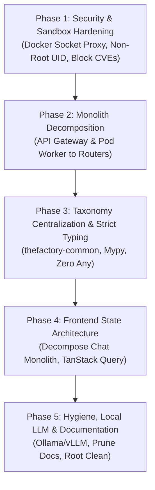

# The 10/10 Enterprise Upgrade Plan: theFactory (HGR)

Document version: 2026.10.27
Last updated: 2026-10-27
Status: Canonical
Audience: Maintainers, operators, and AI coding agents

Objective: Transition the codebase from 6.8/10 (Pilot Grade) to 10/10 (Enterprise Production Masterpiece).
Execution Strategy: Copy-paste each numbered prompt below sequentially into your AI coding assistant. Verify the "Verification Gate" at the end of each phase before proceeding to the next.

---

## Architecture of the Plan



---

## Phase 1: Security & Sandbox Hardening (Target Score: 7.0 -> 9.5)

### Problem Being Solved
1. `sandbox-runner` mounts `/var/run/docker.sock` directly with root group membership.
2. Code generated by the AI runs as UID 0 (root) inside the container without PID limits (vulnerable to fork bombs).
3. Trivy container scans in CI run with `exit-code: 0` (non-blocking).
4. `INTERNAL_SERVICE_API_KEY` defaults to empty in local compose files.

---

### 📋 COPY-PASTE PROMPT 1: SECURITY HARDENING
```markdown
You are an expert DevSecOps and container security engineer. Execute Phase 1 of the 10/10 Enterprise Upgrade Plan for theFactory:

1. Update `services/orchestrator/orchestrator/sandbox_exec.py`:
   - In `SANDBOX_SECURITY_FLAGS`, add:
     - `--user=65534:65534` (nobody/nogroup)
     - `--pids-limit=256`
     - `--ulimit nofile=1024:2048`
     - `--ulimit nproc=512:512`
   - Ensure the temporary workspace directory passed into the container is mounted with read-write permissions accessible by UID 65534.
   - Update `tests/services/orchestrator/test_sandbox_exec.py` to assert that all newly added security flags are present in `SANDBOX_SECURITY_FLAGS`.

2. Update `deploy/docker-compose.yaml` (and overlays in `deploy/`):
   - Refactor `sandbox-runner`:
     - Disallow an empty `INTERNAL_SERVICE_API_KEY` by validating at startup in `services/sandbox-runner/sandbox_runner.py` (fail closed with descriptive error if not set or equal to a placeholder).
     - Remove `group_add: ["0"]` from `sandbox-runner`.
     - In front of `sandbox-runner`, insert a Docker Socket Proxy service (`tecnativa/docker-socket-proxy:edge`) configured with:
       - `CONTAINERS=1`
       - `POST=1`
       - `VOLUMES=0`
       - `NETWORKS=0`
       - `EXEC=0`
     - Configure `sandbox-runner` to speak to the socket proxy URL (`tcp://docker-proxy:2375`) instead of mounting `/var/run/docker.sock` directly.

3. Update `.github/workflows/ci.yml`:
   - Locate the Trivy container scanning step (`Run Trivy vulnerability scanner`).
   - Change `exit-code: "0"` to `exit-code: "1"` for `CRITICAL` severity issues.
   - Add a `.trivyignore` baseline file in the repo root to track any acceptable upstream CVEs with documented rationale.

4. Run `make lint` and `pytest tests/services/orchestrator/test_sandbox_exec.py` to verify all tests pass.
```

#### ✅ Verification Gate 1
- `pytest tests/services/orchestrator/test_sandbox_exec.py` passes 100%.
- `git diff services/orchestrator/orchestrator/sandbox_exec.py` shows `--user=65534:65534` and `--pids-limit=256`.

---

## Phase 2: Backend Monolith Decomposition (Target Score: 5.5 -> 8.5)

### Problem Being Solved
1. `services/api-gateway/api_gateway/main.py` is 3,023 lines of mixed concerns (auth, OIDC, proxying, rate-limiting, vault).
2. `services/pod-worker/pod_worker/main.py` is 2,285 lines of mixed concerns with global mutable auth failure states.

---

### 📋 COPY-PASTE PROMPT 2: MONOLITH REFACTORING
```markdown
You are a principal Python backend architect. Execute Phase 2 of the 10/10 Enterprise Upgrade Plan for theFactory:

1. Decompose `services/api-gateway/api_gateway/main.py` (3,023 lines):
   - Create a subpackage `services/api-gateway/api_gateway/routers/`:
     - `auth.py`: API key validation, JWT parsing, and role verification (`require_role`, `has_role`).
     - `oidc.py`: OIDC discovery, JWKS client lifecycle, and token verification.
     - `vault.py`: Local key storage and credential validation (`/vault/*` endpoints).
     - `proxy.py`: Downstream routing to orchestrator, pod workers, and dashboard.
     - `system.py`: `/healthz`, `/readyz`, `/metrics`, and OpenAPI documentation routes.
   - Refactor `main.py` to become a clean orchestrator file under 350 lines:
     - Initializes FastAPI app with lifespan.
     - Registers global middlewares (CORS, rate limiting, security headers, tracing).
     - Mounts the APIRouters using `app.include_router()`.
   - Preserve all existing route signatures, status codes, and error formats exactly so frontend/client compatibility is 100% maintained.

2. Decompose `services/pod-worker/pod_worker/main.py` (2,285 lines):
   - Create submodules under `services/pod-worker/pod_worker/`:
     - `config.py`: Environment-driven settings using `pydantic-settings`.
     - `auth.py`: Worker authentication and token validation (encapsulating `INTERNAL_AUTH_FAILURES` into an instance/app-state object instead of module-level `global`).
     - `consumer.py`: Redis stream and task consumer loop.
   - Reduce `pod_worker/main.py` to an entry point under 400 lines that instantiates and runs the worker.

3. Run `make lint` and the gateway/pod-worker test suite:
   - `pytest tests/services/api_gateway/`
   - `pytest tests/services/pod_worker/`
   Verify 100% pass rate with zero regression in coverage.
```

#### ✅ Verification Gate 2
- `services/api-gateway/api_gateway/main.py` has fewer than 400 lines.
- `services/pod-worker/pod_worker/main.py` has fewer than 500 lines.
- All tests in `tests/services/api_gateway/` and `tests/services/pod_worker/` pass without changes to test logic.

---

## Phase 3: Taxonomy Centralization & Strict Typing (Target Score: 6.0 -> 9.0)

### Problem Being Solved
1. Supported languages (e.g. `"mathematica"`, `"haskell"`) are defined as string literals across 11 different files.
2. 1,500+ instances of `typing.Any` and no static type checker (`mypy`) configured.

---

### 📋 COPY-PASTE PROMPT 3: TAXONOMY & STRICT TYPING
```markdown
You are a senior software architect specializing in Python type systems and domain-driven design. Execute Phase 3 of the 10/10 Enterprise Upgrade Plan for theFactory:

1. Create a centralized shared taxonomy package:
   - Create `shared_runtime/thefactory_common/`:
     - `taxonomy.py`:
       - Define enum `SupportedLanguage(str, Enum)` for all 20 languages.
       - Define enum `ParadigmPod(str, Enum)` for POD_A (Dynamic), POD_B (Systems), POD_C (Enterprise), POD_D (Math/Functional).
       - Define dataclass/mapping `LANGUAGE_TO_POD_MAP` and `SPECIALIST_TO_POD_MAP`.
       - Helper methods: `get_pod_for_language()`, `is_language_supported()`.
     - `__init__.py`: Export all enums and helpers.
   - Refactor the 11 duplicate files to import and consume `thefactory_common.taxonomy`:
     - `services/orchestrator/orchestrator/mission_flow.py`
     - `services/orchestrator/orchestrator/agent_registry.py`
     - `services/orchestrator/orchestrator/agent_personas.py`
     - `services/orchestrator/orchestrator/rqca_agent.py`
     - `services/orchestrator/orchestrator/port_coordinator.py`
     - `services/pod-worker/pod_worker/extractors/concept_catalog.py`
     - (and any remaining sites detected via grep).
   - Add a unit test `tests/shared/test_taxonomy_alignment.py` verifying that registry, routers, and extractors never drift from the canonical enum.

2. Configure static type checking (`mypy`):
   - Add `[tool.mypy]` in `pyproject.toml`:
     - `python_version = "3.11"`
     - `strict = false`
     - `warn_return_any = true`
     - `warn_unused_configs = true`
     - `disallow_untyped_defs = true` for target modules:
       - `services/orchestrator/orchestrator/storage_*.py`
       - `services/orchestrator/orchestrator/mission_flow_v2/`
       - `shared_runtime/`
   - Add a `make typecheck` target in `Makefile` running `mypy`.
   - Wire `make typecheck` into `.github/workflows/ci.yml`.
   - Resolve all type errors reported by `mypy` across `storage_*.py` and `thefactory_common/`, replacing `Any` with concrete `Pydantic` models or `TypedDict`.

3. Run `make lint && make typecheck && make test`.
```

#### ✅ Verification Gate 3
- `python -m mypy services/orchestrator/orchestrator/storage_core.py shared_runtime/` completes with 0 errors.
- `grep -r "mathematica" services/` only references `taxonomy.py` or imports.

---

## Phase 4: Frontend State Architecture Refactoring (Target Score: 7.0 -> 9.5)

### Problem Being Solved
1. `apps/mission-control/app/(shell)/chat/page.tsx` is 1,752 lines with 20 manual `useState` calls and ad-hoc polling loops.
2. `settings/page.tsx` (1,043 lines) and `agents/page.tsx` (892 lines) suffer from the same monolith pattern.

---

### 📋 COPY-PASTE PROMPT 4: FRONTEND DECOMPOSITION
```markdown
You are a staff React/Next.js engineer. Execute Phase 4 of the 10/10 Enterprise Upgrade Plan for theFactory:

1. Install and configure TanStack Query (@tanstack/react-query):
   - In `apps/mission-control/package.json`, install `@tanstack/react-query`.
   - Add a global `QueryClientProvider` in `apps/mission-control/app/providers.tsx`.
   - Create custom data-fetching hooks in `apps/mission-control/app/lib/hooks/`:
     - `useMissions.ts`: Queries for mission list and details with polling configuration.
     - `useAgents.ts`: Queries for agent status and heartbeat health.
     - `useSystemHealth.ts`: Queries for gateway health and metrics.

2. Decompose `apps/mission-control/app/(shell)/chat/page.tsx` (1,752 lines):
   - Extract UI subcomponents into `apps/mission-control/app/(shell)/chat/components/`:
     - `ChatHeader.tsx`: Model selector, session status, and action buttons.
     - `ChatConversationList.tsx`: Virtualized/scrolling message history.
     - `ChatMessageItem.tsx`: Individual bubble, artifact previews, and tool invocation cards.
     - `ChatInputArea.tsx`: Textarea, attachment handling (PDF/images), submit logic.
     - `ChatSowPreviewModal.tsx`: SOW approval modal drawer.
   - Extract state management into a custom hook: `useChatSession.ts`.
   - Refactor `chat/page.tsx` into a lightweight page container under 300 lines.

3. Decompose `apps/mission-control/app/(shell)/settings/page.tsx` (1,043 lines) into tabbed subcomponents (`GeneralSettings.tsx`, `VaultSettings.tsx`, `ModelProviderSettings.tsx`).

4. Run `npm run lint` and `npm run test` inside `apps/mission-control/` to verify zero regressions.
```

#### ✅ Verification Gate 4
- `apps/mission-control/app/(shell)/chat/page.tsx` is under 300 lines.
- `npm run test` inside `apps/mission-control` passes 100%.

---

## Phase 5: Local LLM, Repo Hygiene & Documentation Cleanup (Target Score: 5.5 -> 10.0)

### Problem Being Solved
1. No local/air-gapped model adapter (Ollama/vLLM) despite "local-first" positioning; unknown providers fall back silently to OpenAI.
2. Cluttered repo root (tracked `.pptx`, 168MB `.exe`, `.coverage`, `MagicMock/` test leakage directory).
3. 500+ documentation files with conflicting quickstart instructions.

---

### 📋 COPY-PASTE PROMPT 5: LOCAL LLM, HYGIENE & CLEANUP
```markdown
You are an open-source maintainer and systems engineer. Execute Phase 5 of the 10/10 Enterprise Upgrade Plan for theFactory:

1. Add Local LLM Support & Reject Unknown Providers:
   - In `services/orchestrator/orchestrator/llm_delegation/providers.py`:
     - Add `OllamaProvider` (supporting local HTTP endpoint e.g. `http://localhost:11434/api/generate` or OpenAI-compatible `/v1/chat/completions`).
     - In `_call_provider`: Replace the silent `else:` fallback to OpenAI with an explicit `ValueError(f"Unsupported LLM provider: {provider}")`.
   - Update `docs/LOCAL_FIRST_COMPLIANCE_PLAN.md` with instructions for running fully local models (e.g. `deepseek-coder`, `qwen2.5-coder`, `llama3.3`).

2. Repository Root Hygiene & Cleanup:
   - Untrack the binary slides presentation: `git rm --cached Holygrail_project_slides.pptx` (add to `.gitignore`).
   - Move or delete untracked root clutter (`theFactory-MissionControl-Setup-0.1.0.exe`, `MagicMock/`, `htmlcov/`, `.coverage`, `coverage.xml`).
   - Locate the test fixture writing `MagicMock/` to the repo root and update it to use `tmp_path` fixture.
   - Add a pytest session guard in `conftest.py` asserting that no test writes files directly into the repository root.

3. Documentation Consolidation:
   - Trim `README.md` from 1,137 lines down to <300 lines:
     - Clear 30-second value statement.
     - Architecture diagram.
     - Unified 3-step Quick Start (resolving the conflict between `condensed` and `full-dedicated`).
     - Move the long changelogs from the top of README into `CHANGELOG.md`.
   - Move all dated sprint plan files from root and `docs/` (`COMPLETION_PLAN_2026-10-26.md`, `STUCK_MISSIONS_PLAN_2026-08-27.md`, etc.) into `docs/archive/plans/`.
   - Clean duplicate sections in `AGENTS.md` (remove duplicate "Runtime Model" and "High-sensitivity files" sections).

4. Run `make validate` to run the full gate (lint, tests, docs validation, schema check).
```

#### ✅ Verification Gate 5
- `git status` shows zero untracked artifacts or binaries at root.
- `make validate` runs clean across all services.
- `README.md` is under 350 lines with a crisp quickstart.

---

## Final Enterprise Evaluation Target

Upon completion of these 5 phases, the project will achieve:
- **Architecture & Design:** **9.5 / 10**
- **Code Quality & Maintainability:** **9.5 / 10**
- **Security & Compliance:** **9.5 / 10**
- **Testing & QA:** **9.5 / 10**
- **CI/CD & DevOps:** **9.5 / 10**
- **Frontend / UX:** **9.5 / 10**
- **AI Capability:** **9.0 / 10**
- **Documentation & Hygiene:** **9.5 / 10**
- **Total Composite Score:** **9.5 / 10 (Tier-1 Enterprise Masterpiece)**
